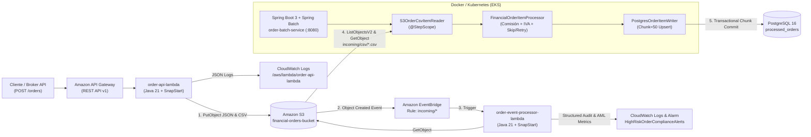

# Serverless & Batch Order Processor


Sistema híbrido de procesamiento de órdenes financieras diseñado para ejecutarse **100% local y sin costo** mediante **LocalStack** y **Docker Compose**, con infraestructura modular en **Terraform** lista para desplegarse también en **AWS Free Tier**.

Combina dos paradigmas complementarios de arquitectura Cloud:
1. **Ingesta y Auditoría Orientada a Eventos en Tiempo Real (Serverless):** `API Gateway` -> `order-api-lambda` (Java 21 + SnapStart) -> `Amazon S3` -> `Amazon EventBridge` -> `order-event-processor-lambda` -> `CloudWatch Logs & Alarms`.
2. **Liquidación Masiva por Lotes (Batch Processing):** Microservicio `order-batch-service` en **Spring Boot 3.3 + Spring Batch 5** (`ItemReader` desde S3, `ItemProcessor` de comisiones/impuestos/reglas, `ItemWriter` idempotente en **PostgreSQL 16**) con tolerancia a fallos (`skip`/`retry`), hilos virtuales de Java 21 y `@RestControllerAdvice` (RFC 7807 `ProblemDetail`).

---

## Arquitectura del Sistema



---

## Estructura del Proyecto

```text
serverless-batch-order-processor/
├── pom.xml                                  # Parent POM multi-módulo (Java 21, AWS SDK v2 BOM, JUnit 5)
├── docker-compose.yml                       # LocalStack 3.7 + PostgreSQL 16 + order-batch-service
├── setup-local.sh                           # Automatización completa para Linux / macOS / Git Bash
├── setup-local.ps1                          # Automatización completa para Windows PowerShell
├── sample-data/
│   └── orders-batch-sample.csv              # Dataset CSV con órdenes válidas, institucionales y fila corrupta (skip test)
├── lambdas/
│   ├── order-api-lambda/                    # Lambda expuesta por API Gateway (POST /orders -> S3 JSON + CSV)
│   └── order-event-processor-lambda/        # Lambda disparada por EventBridge (S3 -> Reglas AML -> CloudWatch)
├── order-batch-service/                     # Microservicio Spring Boot 3.3 + Spring Batch 5 + JPA + PostgreSQL
│   └── Dockerfile                           # Multi-stage con layered JAR y usuario no-root en Eclipse Temurin 21 Alpine
├── terraform/
│   ├── main.tf                              # Orquestador de módulos (LocalStack / AWS real)
│   ├── modules/serverless-core/             # IAM (mínimo privilegio), S3, Lambda, API Gateway, EventBridge, CloudWatch
│   └── aws-only/                            # Referencia IaC de EC2 + Security Group y EKS (enable_paid_resources = false)
├── k8s/                                     # Manifiestos Kubernetes (deployment.yaml, service.yaml, hpa.yaml)
└── docs/
    └── presentacion-interactiva.html        # Presentación interactiva + Simulador de Flujo + Checklist DIY + Flashcards
```

---

## Inicio Rápido (100% Local con LocalStack y Docker)

### Requisitos Previos
- **Docker Desktop** (o Docker Engine + Docker Compose).
- *(Opcional)* **JDK 21**, **Maven 3.9+**, **Terraform 1.5+** y **AWS CLI v2**. Si no los tienes instalados en tu sistema operativo, los scripts `setup-local.ps1` y `setup-local.sh` compilan y ejecutan Terraform automáticamente usando contenedores efímeros de Docker.

### Opción A: Ejecución Automática en 1 Comando

En **Windows (PowerShell)**:
```powershell
.\setup-local.ps1
```

En **Linux / macOS / Git Bash**:
```bash
chmod +x setup-local.sh
./setup-local.sh
```

---

## Guía de Pruebas Paso a Paso (`curl` y `aws --endpoint-url=http://localhost:4566`)

### 1. Obtener la URL del API Gateway desplegado por Terraform
```bash
cd terraform
API_URL=$(terraform output -raw api_gateway_orders_url)
echo "API Gateway Endpoint: $API_URL"
```
*(En PowerShell: `$API_URL = terraform output -raw api_gateway_orders_url`)*

### 2. Enviar una orden financiera vía `POST /orders` (Módulo 1: API Gateway -> Lambda -> S3)
```bash
curl -i -X POST "$API_URL" \
  -H "Content-Type: application/json" \
  -H "X-Correlation-Id: corr-demo-001" \
  -d '{
    "orderId": "ORD-2026-9001",
    "customerId": "CUST-700",
    "ticker": "NVDA",
    "side": "BUY",
    "quantity": 50,
    "unitPrice": 128.40,
    "currency": "USD"
  }'
```

### 3. Probar una orden de alto valor (>= $50,000 USD) para disparar alerta AML en EventBridge + CloudWatch
```bash
curl -i -X POST "$API_URL" \
  -H "Content-Type: application/json" \
  -H "X-Correlation-Id: corr-whale-999" \
  -d '{
    "orderId": "ORD-2026-WHALE",
    "customerId": "CUST-INST-01",
    "ticker": "MSFT",
    "side": "BUY",
    "quantity": 200,
    "unitPrice": 425.00,
    "currency": "USD"
  }'
```

### 4. Verificar los archivos generados en el bucket S3 de LocalStack
```bash
aws --endpoint-url=http://localhost:4566 s3 ls s3://financial-orders-bucket/incoming/ --recursive
```

### 5. Inspeccionar los logs estructurados en JSON en CloudWatch Logs
```bash
# Logs de la Lambda de ingesta (API Gateway)
aws --endpoint-url=http://localhost:4566 logs tail /aws/lambda/order-api-lambda

# Logs de la Lambda procesadora disparada por EventBridge
aws --endpoint-url=http://localhost:4566 logs tail /aws/lambda/order-event-processor-lambda
```

### 6. Disparar el Job de Liquidación Masiva en Spring Batch (`POST /api/v1/batch/jobs/orders`)
El job lee todos los archivos CSV dentro de `s3://financial-orders-bucket/incoming/csv/`, calcula comisiones por tramo (`0.25%` estándar o `0.15%` institucional >= `$10,000`), aplica el `16%` de IVA sobre la comisión, salta filas corruptas (`OrderSkipListener`) y guarda el resultado en PostgreSQL:

```bash
curl -s -X POST http://localhost:8080/api/v1/batch/jobs/orders \
  -H "Content-Type: application/json" \
  -d '{
    "s3Prefix": "incoming/csv/",
    "triggeredBy": "MANUAL_DEMO"
  }'
```

### 7. Consultar las órdenes liquidadas en PostgreSQL
```bash
curl -s http://localhost:8080/api/v1/batch/orders
```

---

## Guía de Costos: ¿Qué desplegar en AWS Free Tier y qué dejar en LocalStack?

Para desplegar los recursos gratuitos en una cuenta real de AWS, basta con cambiar `-var="use_localstack=false"` manteniendo `-var="enable_paid_resources=false"`:

| Componente | Estado en Terraform | ¿Incluido en AWS Free Tier? | Recomendación del Arquitecto |
| :--- | :--- | :--- | :--- |
| **AWS Lambda** (`order-api-lambda` y `order-event-processor-lambda`) | Activo (`modules/serverless-core`) | **Sí (Siempre Gratis):** 1,000,000 de invocaciones y 400,000 GB-seg al mes. | Seguro para desplegar en AWS real y LocalStack. |
| **Amazon S3** (`financial-orders-bucket`) | Activo (`modules/serverless-core`) | **Sí (12 meses):** 5 GB de almacenamiento estándar, 20,000 `GET` y 2,000 `PUT`. | Seguro en AWS Free Tier; `force_destroy = true` facilita limpiar con `terraform destroy`. |
| **Amazon API Gateway** (REST API) | Activo (`modules/serverless-core`) | **Sí (12 meses):** 1,000,000 de llamadas REST al mes. | Seguro en AWS Free Tier. |
| **Amazon EventBridge** (Reglas S3) | Activo (`modules/serverless-core`) | **Sí:** Los eventos de servicios nativos de AWS en el bus por defecto son gratuitos. | Seguro en AWS Free Tier. |
| **Amazon CloudWatch** (Logs + 1 Alarma) | Activo (`modules/serverless-core`) | **Sí (Siempre Gratis):** 5 GB de ingesta de logs y hasta 10 métricas/alarmas personalizadas. | Configurado con retención de 14 días (`retention_in_days = 14`) para no acumular almacenamiento. |
| **AWS IAM** (Roles y Policies PoLP) | Activo (`modules/serverless-core`) | **Sí (Siempre Gratis):** Sin costo en AWS. | Principio de mínimo privilegio aplicado por recurso. |
| **Amazon EC2** (`t3.micro` + Security Group) | Protegido en `/terraform/aws-only` (`enable_paid_resources = false`) | **Parcial (12 meses):** 750 horas/mes de `t3.micro`/`t2.micro` en cuentas nuevas. | Mantener `enable_paid_resources = false` y validar con `terraform plan -var="enable_paid_resources=true"`. |
| **Amazon EKS** (Cluster + Managed Node Group) | Protegido en `/terraform/aws-only` (`enable_paid_resources = false`) | **No:** El plano de control de EKS cuesta **\$0.10 USD/hora (~\$73 USD/mes)** más las instancias `t3.medium`. | **Nunca ejecutar `apply` con EKS en cuentas personales gratuitas.** Usa `terraform plan` para demostrar dominio de IaC y despliega los manifiestos de `/k8s` en Kubernetes local (Docker Desktop / Minikube / Kind). |
| **PostgreSQL 16** | En `docker-compose.yml` | En AWS RDS tienes 750 hrs de `db.t3.micro` por 12 meses. | Mantener en contenedor Docker local para desarrollo sin consumir horas de RDS. |

---

## Presentación Interactiva y Laboratorio Guiado

Abre directamente en tu navegador el archivo:
- [`docs/presentacion-interactiva.html`](./docs/presentacion-interactiva.html)

Incluye:
1. **Mapa de Arquitectura Interactivo:** Haz clic en cada uno de los 9 componentes para ver su rol arquitectónico, el código real que lo implementa y su modo de fallo/resiliencia.
2. **Simulador Paso a Paso del Flujo de Datos:** Recorre con botones *Anterior / Siguiente* cómo viaja una orden desde el JSON en `POST /orders` hasta convertirse en una fila liquidada con comisión e IVA en PostgreSQL.
3. **Checklist "Hazlo tú mismo" (DIY):** Guía interactiva con persistencia en `localStorage` y botones para copiar comandos.
4. **Flashcards de Entrevista Técnica Senior:** Preguntas avanzadas sobre Cold Starts, SnapStart (`CRaC`), idempotencia en Spring Batch, `FaultTolerantStep`, EventBridge vs S3 Notifications e IAM Least Privilege.
